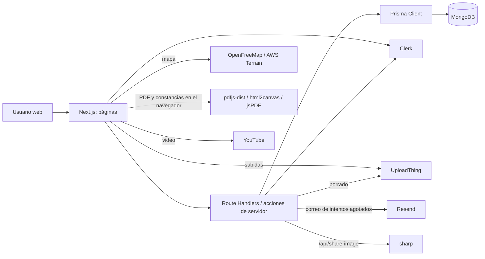

# Arquitectura del Sistema

## 1. Propósito

Describir cómo interactúan el frontend, backend, base de datos y servicios externos de la plataforma Aula STEAM: cursos, evaluaciones, constancias, blog, feed de eventos, Trayectoria y analíticas.

## 2. Vista general de componentes

| Componente | Tecnología |
|------------|------------|
| Frontend y backend | Next.js 15 (App Router), React, TypeScript, Tailwind CSS |
| Backend | Route Handlers (`app/api/`) y acciones de servidor (`actions/`) |
| Base de datos | MongoDB con Prisma ORM |
| Autenticación | Clerk |
| Archivos | UploadThing |
| Correo | Resend (API REST) |
| Mapa | MapLibre GL, OpenFreeMap y AWS Terrain Tiles |
| PDF e imágenes en el navegador | `pdfjs-dist` (PDF → páginas), `html2canvas` + `jsPDF` (constancias), `jszip` (descarga en lote) |
| Imágenes en el servidor | `sharp` (`/api/share-image`) |
| Video de módulos | YouTube (iframe) |

## 3. Diagrama de arquitectura lógica

## 4. Flujo principal de operación

1. El usuario navega las páginas públicas o inicia sesión con Clerk.
2. `middleware.ts` deja pasar las rutas públicas y exige sesión en las demás.
3. Las páginas de servidor leen la base con Prisma o con las funciones de `actions/` y `lib/`.
4. Los formularios llaman a las rutas de `app/api/` (cursos, evaluaciones, blog, eventos) o a las acciones de servidor (Trayectoria).
5. Los archivos se suben desde el navegador a UploadThing; la base guarda sus URLs.
6. Resend envía el correo de intentos agotados en evaluaciones.

## 5. Organización del código

### 5.1 `app/`

| Carpeta | Contenido |
|---------|-----------|
| `(auth)/` | `/sign-in` y `/sign-up` (Clerk) |
| `(course)/courses/[courseId]/` | Vista del estudiante: módulos, evaluaciones y constancia, con su propio layout y menú |
| `(dashboard)/(routes)/` | Páginas con el layout principal: inicio (`(root)`), `about`, `search`, `mycourses`, `feed`, `blog`, `trayectoria` |
| `(dashboard)/(routes)/teacher/` | Panel del profesor: `courses`, `create`, `feed`, `blog`, `trayectoria`, `certificates`, `analytics` |
| `(public)/certificate/verify/` | Verificación pública de constancias, sin el layout principal |
| `api/` | Route Handlers (ver [api.md](api.md)) |
| `layout.tsx`, `robots.ts`, `sitemap.ts` | Layout raíz, metadatos y archivos para buscadores |

Los componentes propios de cada página están en carpetas `_components/` junto a ella.

### 5.2 Otras carpetas

| Carpeta | Contenido |
|---------|-----------|
| `actions/` | Consultas de servidor reutilizables (cursos, progreso, analíticas, constancias) y acciones de Trayectoria (`timeline.ts`) |
| `lib/` | Cliente de Prisma (`db.ts`), profesor (`teacher.ts`), evaluaciones y reintentos, correo, blog, compartir, slugs, Trayectoria y UploadThing |
| `components/` | Componentes compartidos: `ui/` (shadcn/ui), `modals/`, `providers/`, tarjetas de cursos, buscador, subida de archivos |
| `hooks/` | `use-debounce.ts` (búsqueda) |
| `types/` | Tipos de `page-flip` para el lector de Trayectoria |
| `prisma/` | Esquema y documentación de datos |
| `content/` | Texto de la portada del mapa de Trayectoria |
| `scripts/` | Scripts de datos (`seed.ts`, `migrate-course-categories.ts`) |
| `public/` | Imágenes, logo, firma de constancias, imagen para compartir y worker de PDF.js |

## 6. Documentación por módulo

- [Trayectoria](modulos/trayectoria.md)
- [Blog](modulos/blog.md)
- [Evaluaciones y reintentos](modulos/evaluaciones-y-reintentos.md)
- [Certificados](modulos/certificados.md)
- [Feed y analíticas](modulos/feed-y-analiticas.md)
- [Roles y permisos](roles-y-permisos.md) · [Variables de entorno](variables-entorno.md) · [Modelo de datos](modelo-datos.md)
