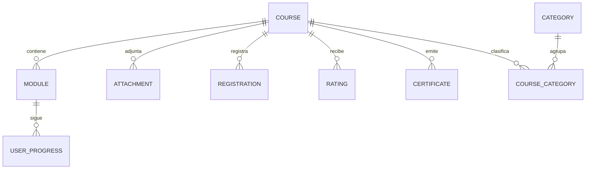
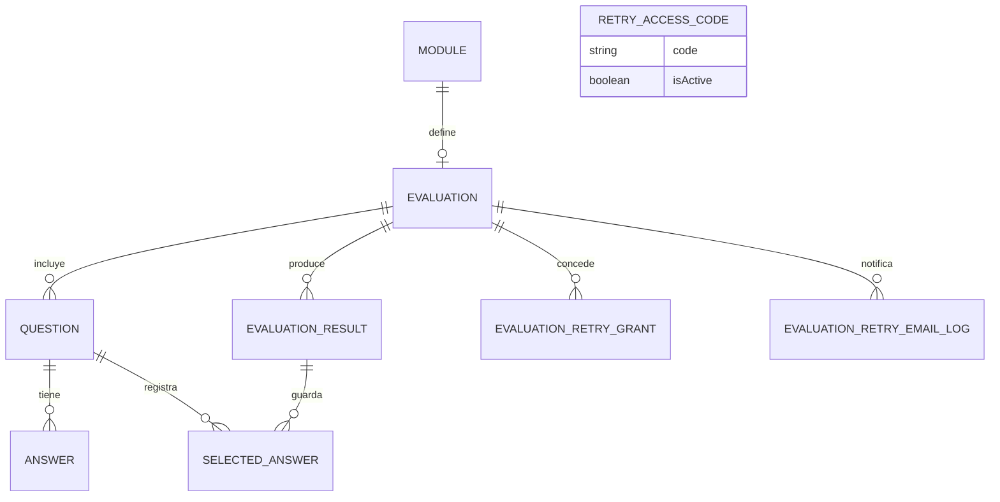
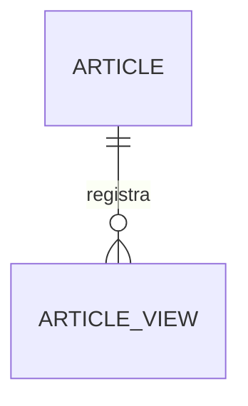
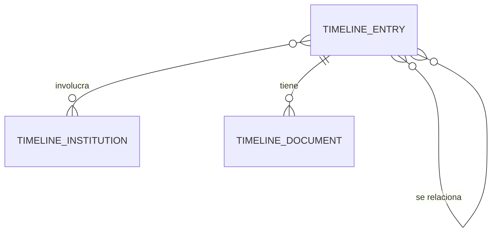
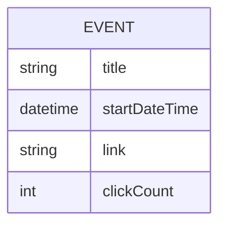

# Modelo de Datos

## 1. Tecnología y enfoque

La persistencia utiliza MongoDB con Prisma ORM (`provider = "mongodb"`). El esquema está en `prisma/schema.prisma` y el detalle de cada campo en [`prisma/documentation.md`](../../prisma/documentation.md). Los usuarios están en Clerk; los modelos guardan su `userId` como texto.

## 2. Entidades por dominio

| Dominio | Entidades |
|---------|-----------|
| Cursos | `Course`, `Category`, `CourseCategory`, `Module`, `Attachment`, `Registration`, `UserProgress`, `Rating` |
| Evaluaciones | `Evaluation`, `Question`, `Answer`, `EvaluationResult`, `SelectedAnswer`, `RetryAccessCode`, `EvaluationRetryGrant`, `EvaluationRetryEmailLog` |
| Certificados | `Certificate` |
| Blog | `Article`, `ArticleView` |
| Trayectoria | `TimelineEntry`, `TimelineInstitution`, `TimelineDocument` |
| Eventos | `Event` |

## 3. Diagramas entidad-relación

### 3.1 Cursos y certificados

### 3.2 Evaluaciones

`RetryAccessCode` no tiene relaciones declaradas.

### 3.3 Blog

### 3.4 Trayectoria

Imágenes, lugares, historia, cita y páginas de documentos son tipos embebidos dentro de cada registro.

### 3.5 Eventos

## 4. Restricciones clave

- `Module` 1:1 opcional `Evaluation` (`moduleId` único).
- `CourseCategory`: único `[courseId, categoryId]`.
- `EvaluationRetryEmailLog`: único `[userId, evaluationId, attempt]`.
- Únicos: `RetryAccessCode.code`, `Article.slug`, `TimelineEntry.slug`, `TimelineInstitution.name` y `slug`, `TimelineDocument` `[entryId, slug]`.
- `TimelineDocument` se borra en cascada con su `TimelineEntry`.

## 5. Notas para mantenimiento

- Los IDs son `ObjectId` mapeados en `_id`.
- `npx prisma db push` sincroniza índices y restricciones únicas. Los cambios en datos ya guardados se hacen con scripts como `scripts/migrate-course-categories.ts`.
- Un cambio de entidades debe reflejarse en las rutas API, las acciones del servidor, los formularios y [`prisma/documentation.md`](../../prisma/documentation.md).
