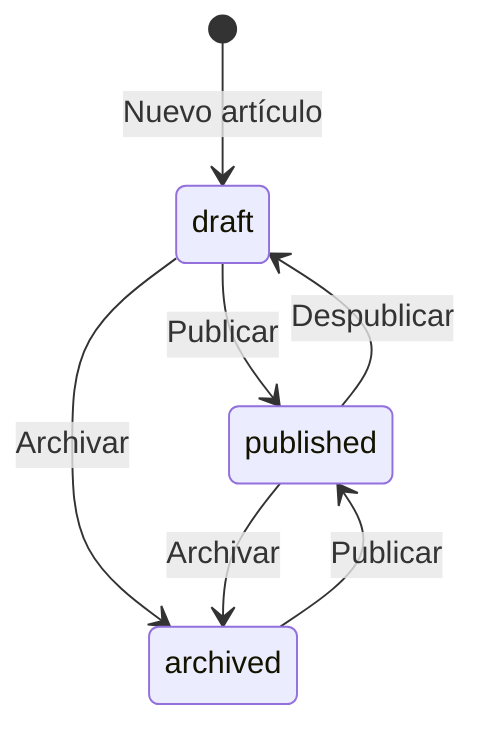

# Módulo: Blog

## 1. Propósito

El blog publica historias, perfiles y noticias. El profesor escribe cada artículo en un editor por bloques, elige una plantilla y lo publica. Modelos: `Article` y `ArticleView` (ver [`prisma/documentation.md`](../../../prisma/documentation.md)).

## 2. Rutas

| Ruta | Qué hace |
|------|----------|
| `/blog` | Artículos publicados agrupados por año |
| `/blog/<slug>` | Lector del artículo |
| `/teacher/blog` | Tabla de artículos y botón "Nuevo artículo" |
| `/teacher/blog/<slug>` | Editor (la carpeta se llama `[articleId]`, pero recibe el slug) |

Endpoints en `app/api/blog/` y `app/api/share-image/`; ver [api.md](../api.md).

## 3. Plantillas

| Valor | Etiqueta |
|-------|----------|
| `cover_person` | Personaje |
| `full_article` | Artículo |
| `profile_simple` | Perfil |
| `news_short` | Noticia |

Cada plantilla tiene su lector en `blog/[slug]/_components/readers/`. En celular todas usan `mobile-reader.tsx` (diapositivas). El artículo tiene dos colores editables: acento y columna oscura.

## 4. Contenido

`Article.blocks` es una lista de bloques: `paragraph` (mín. 10 caracteres), `pullquote` (mín. 4), `image`, `list` (algún ítem de 3 o más) y `divider`. Los bloques que no cumplen el mínimo se descartan al guardar. Máximo 3 imágenes por artículo, contando la portada. Las imágenes se suben a UploadThing con la ruta `courseImage`.

## 5. Ciclo de vida

- El editor guarda solo, 1,5 s después de cada cambio.
- Un artículo publicado se ve en solo lectura en el editor; para editarlo se despublica.
- Para publicar se requiere título, nombre del autor, portada y contenido válido.
- El slug (`lib/slug.ts`) sigue al título hasta la primera publicación; después no cambia.
- Si la frase gancho está vacía al publicar, se genera del subtítulo o el título.
- Eliminar borra el artículo, sus vistas y sus imágenes en UploadThing.

## 6. Vistas

Una vista se registra cuando el lector llega al final del artículo (`POST /api/blog/articles/[slug]/views`). Cada lectura completa suma una vista. El total se muestra en `/blog`, en el lector y en el panel.

## 7. Compartir

- `lib/share-link.ts`: abre el menú de compartir del dispositivo o copia el enlace.
- `lib/share-metadata.ts`: metadatos Open Graph y de X/Twitter de cada página. En un artículo usa la portada, el subtítulo y el autor.
- `/api/share-image?src=<url>`: entrega la imagen de UploadThing recortada a 1200 × 630 en JPEG. Sin imagen se usa `public/og-aula-steam.png`.
