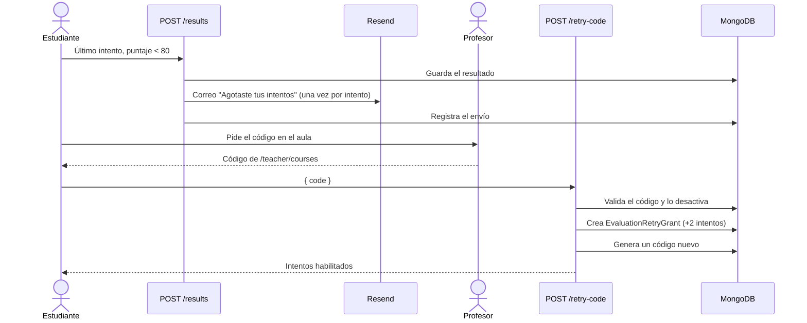

# Módulo: Evaluaciones y reintentos

## 1. Propósito

Cada módulo puede tener una evaluación con un número limitado de intentos. Se aprueba con **80 o más**, y aprobar marca el módulo como completado. Al agotar los intentos sin aprobar, el estudiante recibe un correo y puede canjear un **código de reintento** que da 2 intentos más.

## 2. Archivos principales

| Archivo | Responsabilidad |
|---------|-----------------|
| `lib/evaluation.ts` | Tipos de pregunta y etiquetas |
| `lib/evaluation-retry.ts` | Código de reintento e intentos permitidos |
| `lib/evaluation-email.ts` | Correo de intentos agotados (Resend) |
| `app/api/courses/[courseId]/modules/[moduleId]/evaluations/` | API de evaluaciones, preguntas, resultados y canje de código |
| `teacher/courses/.../evaluations/[evaluationId]/` | Pantalla del profesor |
| `(course)/courses/.../evaluations/[evaluationId]/` | Pantalla del estudiante |

## 3. Tipos de pregunta

| Tipo | Para publicar | Se califica correcta si… |
|------|---------------|--------------------------|
| Selección única | 2+ opciones, exactamente 1 correcta | Elige la correcta |
| Selección múltiple | 2+ opciones, 1+ correctas | Elige todas las correctas y ninguna otra |
| Respuesta abierta | 1+ respuestas aceptadas | El texto coincide con una aceptada (sin distinguir mayúsculas) |
| Secuencial | 2+ pasos | El orden coincide con el de creación |

Una evaluación puede mezclar tipos. Los pasos de las secuenciales se muestran desordenados.

## 4. Configuración por el profesor

1. Crear la evaluación desde el módulo.
2. Definir los intentos máximos (1 a 10).
3. Crear las preguntas.
4. Publicar. Requiere al menos una pregunta y que todas cumplan la regla de su tipo.

Despublicar o eliminar la evaluación también despublica el módulo y, si no quedan módulos publicados, el curso.

## 5. Resultado

- Puntaje = preguntas correctas / total × 100, redondeado. Se calcula en el navegador y se guarda con `POST .../results`, que verifica que queden intentos.
- Intentos permitidos = `maxAttempts` + intentos concedidos por códigos.
- Con 80 o más se marca el módulo como completado (`PUT .../progress`).
- El estudiante ve su historial de intentos y, según el resultado, puede reintentar, mejorar su nota o continuar.

## 6. Código de reintento

- Un solo código activo para todas las evaluaciones, de 8 caracteres y de un solo uso.
- El profesor lo ve en `/teacher/courses` ("Código universal de reintento").
- Se acepta solo si el estudiante no ha aprobado y no le quedan intentos.
- Al canjearlo se conceden 2 intentos, el código se desactiva y se genera uno nuevo.

## 7. Correo de intentos agotados

`lib/evaluation-email.ts` llama a la API de Resend con `RESEND_API_KEY` y `RESEND_FROM_EMAIL` (ver [variables de entorno](../variables-entorno.md)). Se envía al correo de la cuenta Clerk del estudiante y se registra en `EvaluationRetryEmailLog`. Si faltan las variables, el intento se guarda sin enviar correo.
