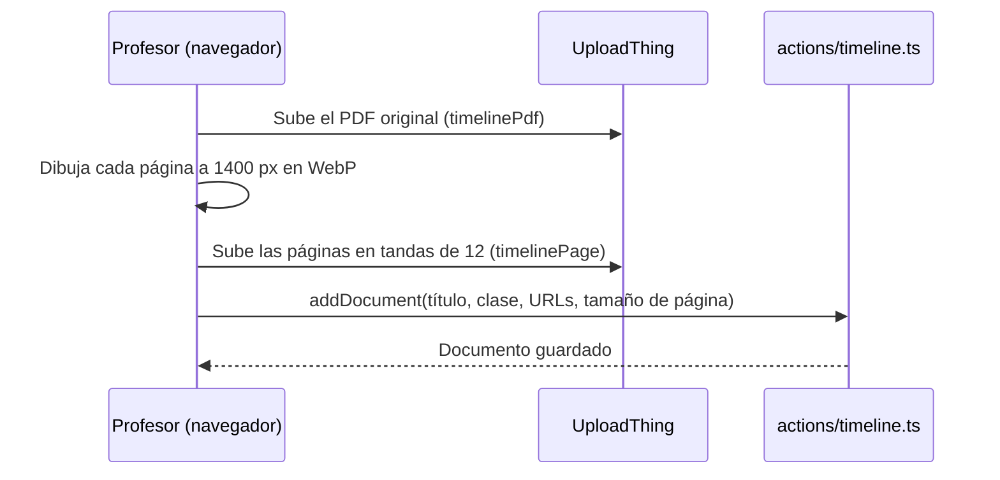

# Módulo: Trayectoria

## 1. Propósito

Trayectoria muestra los **proyectos**, **participaciones** y **alianzas** del Aula STEAM en un mapa con línea de tiempo, con una página por proyecto, un lector de documentos y una estantería de publicaciones. El contenido se edita en `/teacher/trayectoria` y se guarda en `TimelineEntry`, `TimelineInstitution` y `TimelineDocument` (ver [modelo de datos](../modelo-datos.md)).

## 2. Rutas

| Ruta | Qué muestra |
|------|-------------|
| `/trayectoria` | Mapa y línea de tiempo de los registros publicados |
| `/trayectoria/<slug>` | Página de un proyecto |
| `/trayectoria/<slug>/lector/<doc>` | Lector de un documento del proyecto |
| `/trayectoria/publicaciones` | Estantería con los documentos de todos los proyectos |
| `/teacher/trayectoria` | Tabla de registros (borradores y publicados) |
| `/teacher/trayectoria/create` | Crear un registro: tipo y nombre |
| `/teacher/trayectoria/<entryId>` | Editar, publicar, despublicar o eliminar un registro |

Las páginas públicas están en `app/(dashboard)/(routes)/trayectoria/` y las del panel en `app/(dashboard)/(routes)/teacher/trayectoria/`.

## 3. Archivos principales

| Archivo | Responsabilidad |
|---------|-----------------|
| `lib/timeline-data.ts` | Lecturas del sitio público, con caché |
| `lib/timeline-admin.ts` | Lecturas del panel |
| `actions/timeline.ts` | Acciones de servidor: crear, guardar, publicar, eliminar y documentos |
| `lib/timeline-upload.ts` | Compresión de fotos y conversión de PDF a páginas, en el navegador |
| `lib/timeline.ts`, `lib/projects.ts` | Tipos y funciones de formato compartidos |
| `teacher/trayectoria/_components/draft.ts` | Límites y campos obligatorios para publicar |
| `content/proyectos-portada.json` | Título y texto de la tarjeta de bienvenida del mapa |

## 4. Tipos de registro

| Tipo | Página propia | Campos propios | Fotos | Documentos |
|------|---------------|----------------|-------|------------|
| Proyecto | Sí | Historia, cita destacada, agradecimientos, enlace externo, instituciones | 2 | Sí |
| Participación | No | Fecha, modalidad, organizador, motivo, ponente, instituciones aliadas | 1 | No |
| Alianza | No | La institución aliada es el título | 1 | No |

- Hasta 6 lugares por registro; cada uno es un punto en el mapa. Las participaciones virtuales no tienen lugares y solo aparecen en la línea de tiempo.
- Un registro sin año de cierre se ubica en el año actual.
- Las participaciones y alianzas pueden relacionarse con proyectos o participaciones; la página del proyecto las lista.
- Cada institución se registra una vez y se reutiliza por nombre (sin tildes ni mayúsculas).

## 5. Mapa

`trayectoria/_components/projects-map.tsx`, con MapLibre GL, mapa base de OpenFreeMap y relieve de AWS Terrain Tiles.

- El selector de tipo y la línea de tiempo filtran los puntos; al elegir un año aparecen sus tarjetas.
- Al desplazarse por las tarjetas el mapa vuela al punto correspondiente; los puntos cercanos se agrupan.
- El tipo, el año y el registro abierto quedan en la URL: `?tipo=proyectos|participaciones|alianzas&anio=&registro=<slug>`.

## 6. Documentos

Hay dos grupos: **publicaciones y entregables** (periódico, revista, cartilla, libro, entregable, otro) e **informes**. El primero de las publicaciones es el destacado de la página del proyecto y de su tarjeta en el mapa.

Al subir un PDF (máx. 32 MB), el navegador lo convierte en imágenes con `pdfjs-dist`:

- `public/pdf.worker.min.mjs` es el worker de PDF.js y corresponde a la versión de `pdfjs-dist` instalada.
- El lector (`flip-book.tsx`) usa `page-flip` y `react-zoom-pan-pinch`: pasa páginas con `←` `→`, hace zoom con `+` `−`, tiene pantalla completa y descarga del PDF.

## 7. Publicación y caché

Para publicar se exige título, descripción corta, periodo (o fecha y modalidad), ubicación con al menos un punto (salvo participaciones virtuales) y una imagen.

El slug sigue al título hasta la primera publicación. Después solo cambia cuando un registro en curso se cierra: gana el año y el anterior queda en `previousSlugs`, que redirige.

Las lecturas públicas usan `unstable_cache` con la etiqueta `timeline`. Se renuevan al publicar, despublicar o guardar un registro publicado. Si se escribe directamente en la base, hay que borrar `.next/cache/fetch-cache` (en local, con el servidor apagado) o guardar cualquier registro publicado desde el panel.

## 8. Agregar un proyecto

1. En `/teacher/trayectoria`, crear un registro de tipo **Proyecto** con su nombre.
2. Completar descripción corta, periodo, ubicación (coordenadas o enlace largo de Google Maps) y 1 o 2 fotos.
3. Completar lo opcional: historia, cita, agradecimientos, enlace externo, instituciones.
4. Subir los PDF en *Publicaciones y entregables* o en *Informes* y ordenarlos arrastrando.
5. **Publicar** y revisar en `/trayectoria`.
